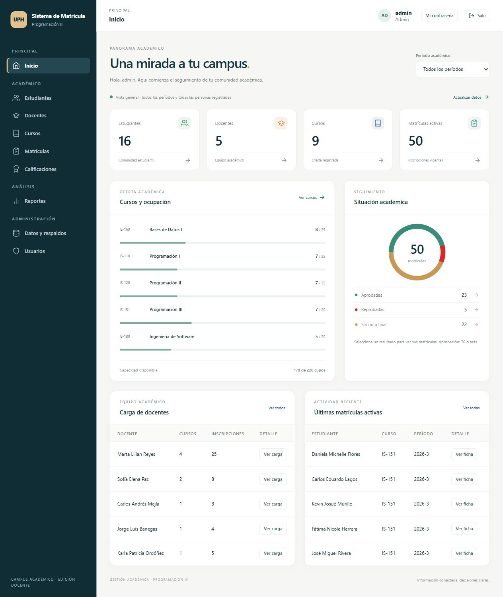

# Campus académico · versión 4

Sistema didáctico de Programación III basado en el proyecto `matricula_api_v3`.
Conserva sus ocho módulos y añade expedientes, hojas de matrícula, historial por
período, carga docente y un dashboard interactivo con diseño renovado.



## Ejecutar en Windows

Requiere Python instalado y conexión a internet durante la instalación de dependencias.
Para una instalación nueva se recomienda Python 3.12 o 3.13. La validación realizada
en este entorno usó Python 3.14; consulte `VALIDACION.md`.

1. Extraiga el ZIP completo en una carpeta nueva.
2. Ejecute `INSTALAR_WINDOWS.bat`.
3. Cree la contraseña de `admin` (mínimo 12 caracteres). Al escribirla no se ve:
   es el comportamiento normal de la terminal. Confírmela cuando se lo pida.
4. Acepte cargar los datos ficticios si quiere probarlo en clase.
5. Ejecute `INICIAR_WINDOWS.bat` y deje abierta la ventana.
6. Abra http://127.0.0.1:8000 y entre con `admin` y su contraseña.
7. Detenga el servidor con Ctrl+C en la terminal.

No se envían contraseñas predeterminadas ni bases de datos dentro del ZIP.
En **Usuarios** puede crear cuentas de administrador o docente con claves propias.

Instalación manual desde la carpeta que contiene `main.py`:

```powershell
python -m venv venv
.\venv\Scripts\python.exe -m pip install -r requirements.txt
.\venv\Scripts\python.exe configurar.py
.\venv\Scripts\python.exe -m uvicorn main:app --host 127.0.0.1 --port 8000
```

Si `python` no se reconoce, puede usar `py -3.13 -m venv venv` para crear el entorno.
Si otro servidor ocupa el puerto 8000, deténgalo o cambie `--port 8000` por
`--port 8001` y abra ese puerto en el navegador.

## Qué puede probar

- **Inicio:** seleccione un período. Pulse las tarjetas, un curso o una categoría
  del gráfico para consultar los registros. Los accesos «Ver todos» llevan al
  módulo completo, con todos los períodos.
- **Estudiantes:** busque un alumno y pulse el icono «Matrícula e historial».
  La hoja permite filtrar por período; el historial muestra todos. Use
  «Imprimir / PDF» para abrir la impresión del navegador.
- **Docentes:** consulte sus cursos y la lista de estudiantes de cada clase.
- **Cursos:** mantenga créditos, cupo, docente, período, horario y aula.
- **Matrículas:** inscriba y retire estudiantes sin borrar el registro de matrícula.
- **Calificaciones:** capture tres parciales; se aprueba con promedio de 70 o más.
- **Reportes:** consulte gráficos, filtros, ranking y listados paginados.
- **Datos y respaldos:** cargue datos ficticios en una base vacía, importe y exporte
  CSV, y cree o descargue copias de seguridad (solo administrador).
- **Usuarios:** cree o elimine cuentas. «Mi contraseña» permite cambiar la propia
  e invalida la sesión para que vuelva a iniciar sesión.

Los datos ficticios incluyen 16 estudiantes, 5 docentes, 9 ofertas de cursos y
ejemplos de 2026-1 y 2026-3. Son exclusivamente para demostración.

## Roles

| Acción | Administrador | Docente |
|---|---|---|
| Consultar información académica, expedientes y reportes | Sí | Sí |
| Crear, editar, retirar o eliminar registros | Sí | No |
| Guardar calificaciones | Sí | No |
| Administrar usuarios, exportar/importar y descargar respaldos | Sí | No |
| Cambiar su propia contraseña y cerrar sesión | Sí | Sí |

La política docente es de lectura general para el ejemplo de aula. No hay acceso
por alumno ni restricción de lectura a cursos propios. Para permitir que un docente
califique solamente sus cursos se debe vincular su cuenta con el registro docente
y definir esa autorización adicional; esta versión conserva la escritura en admin.

## Protección incorporada

- Contraseñas PBKDF2-HMAC-SHA256 con sal aleatoria y 600 000 iteraciones.
- Migración de hashes anteriores a 600 000 iteraciones tras un login correcto.
- Tokens aleatorios con duración de dos horas; en la base se almacena solo su hash.
  Cada cuenta mantiene una sesión; un nuevo login reemplaza la anterior.
- Cookie HttpOnly y SameSite=Strict; verificación CSRF en escrituras desde cookies.
- Roles validados y autorizaciones comprobadas en el servidor.
- Límite de cinco fallos por usuario y treinta por IP en una ventana de cinco minutos.
- Cambio de contraseña y logout que revocan la sesión.
- Escape de texto en la web, CSP sin scripts inline y respuestas sin caché.
- Consultas SQL parametrizadas, cierre explícito de conexiones y transacción con
  bloqueo de escritura al verificar cupo y matricular.
- Auditoría básica de escrituras exitosas, disponible en `GET /auth/auditoria`
  para administradores. No registra contraseñas, tokens ni cuerpos de peticiones.
- Neutralización de fórmulas al exportar texto a CSV para abrirlo en hojas de cálculo.

Los respaldos contienen información privada y hashes de contraseñas; su acceso
queda restringido a admin. No están cifrados. No los publique en GitHub.

## Modelo de períodos e historial

Cada registro de `cursos` representa una oferta y tiene un período descriptivo,
por ejemplo `2026-3`. Para ofertar una asignatura de nuevo cree otro registro con
un código de oferta distinto, por ejemplo `IS-151-2027-1`. No cambie el período
de una oferta con matrículas: se protege para conservar su historial.

Los cursos migrados desde v3 quedan como **Sin período**; el administrador puede
clasificarlos una vez. No se inventa su período a partir de fechas. El horario y
el aula son informativos: no se comprueban choques de horarios ni requisitos.

La hoja suma matrículas con estado `activa`, incluso si ya tienen nota final; las
retiradas solo aparecen en el historial. «Clases sin nota final» distingue las que
siguen en proceso. Reactivar un retiro conserva el comportamiento de v3: reutiliza
la misma matrícula. No hay una bitácora completa de cada transición de estado.
Las UV aprobadas se suman por oferta con matrícula activa y nota aprobada; no se
deduplican equivalencias o asignaturas repetidas entre ofertas.

## Utilizar una base v3 existente

Detenga el servidor y haga una copia de su `matricula.db` fuera de la carpeta del
proyecto. En una copia de esa base, la versión v4 añade columnas y tablas sin
borrar estudiantes, cursos o notas. Colóquela junto a `main.py` y ejecute
`configurar.py`. Si admin conserva la clave de demostración, el asistente exige
reemplazarla. Las sesiones v3 no se reutilizan: inicie sesión nuevamente.

No copie bases de los otros proyectos `API_Sistema_Academico...`: utilizan otro
modelo de datos. Los respaldos completos son para conservación y restauración
manual; la web no implementa restauración. El CSV de cursos conserva el formato
básico de v3 y no es un mecanismo de respaldo de toda la información.

## Swagger y pruebas

Abra http://127.0.0.1:8000/docs. Ejecute `POST /auth/login`, copie `token` y péguelo
en **Authorize** como Bearer Token. No necesita escribir «Bearer» delante del valor.
La web usa cookies con CSRF; Swagger puede usar el token explícito en Authorization.

```powershell
.\venv\Scripts\python.exe -m pip install -r requirements-dev.txt
.\venv\Scripts\python.exe -m pytest -q
```

Las pruebas usan bases temporales y no modifican su base de trabajo.
`requirements-lock.txt` fija las versiones de ejecución comprobadas y auditadas;
se aplica automáticamente al instalar `requirements.txt`.
Consulte `GUIA_DOCENTE_V4.md` para el recorrido de clase y `VALIDACION.md` para los
resultados comprobados y sus límites.

## GitHub y despliegue

El `.gitignore` excluye bases, respaldos, entornos virtuales y `.env`. Antes de su
primer commit revise `git status` y use únicamente datos ficticios.

El inicio incluido escucha solo en su equipo. Un despliegue público requiere HTTPS,
configuración del servidor y revisión adicional. Con HTTPS defina
`MATRICULA_COOKIE_SECURE=1` para marcar las cookies como Secure. No interprete el
ejemplo como una auditoría externa de seguridad ni como una plataforma lista para
operar una universidad. El historial académico es una consulta sin firma institucional.
